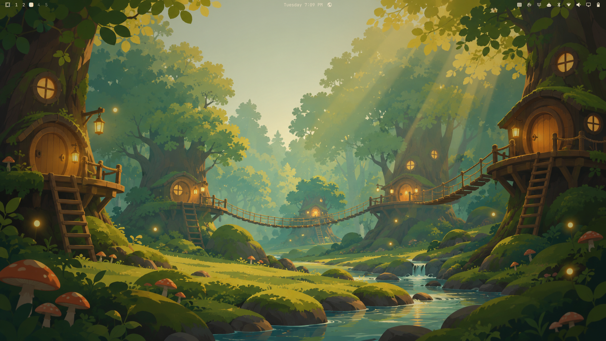

# Hero

A dark, forest-green [Omarchy](https://omarchy.org) theme with warm amber accents and adventure-themed wallpapers.



## Palette

| | |
|---|---|
| Mode | Dark |
| Accent | `#e8a53c` (amber) |
| Background | `#16211a` (deep forest green) |
| Foreground | `#e8dcc0` (warm cream) |

## Backgrounds

Four wallpapers at 2560x1440: forest, field, market, village.

## Editors

- **Neovim**: LazyVim with `tokyonight.nvim` recoloured to the Hero palette.
- **VS Code**: Everforest Dark (closest match; there is no Hero extension).

## Icons

Uses the `Yaru-sage` icon theme.

## Installation

From the Omarchy menu choose **Install > Style > Theme** and paste:

```
https://github.com/justinhhorner/omarchy-hero-theme
```

or run:

```bash
omarchy theme install https://github.com/justinhhorner/omarchy-hero-theme
```

Then select **Hero** from **Style > Theme**.

## License

[MIT](LICENSE)
